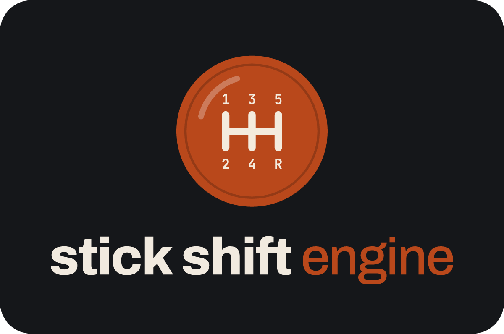
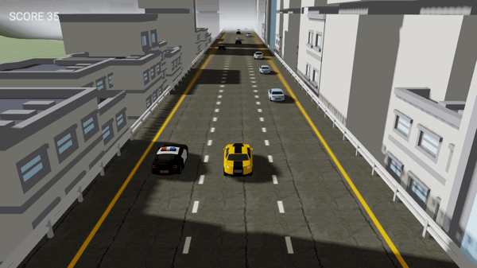

<div align="center">



**A Rust game engine for Apple platforms, rendering with raw Metal.**

[](https://github.com/parsabee/StickShiftEngine/actions/workflows/ci.yml)
[](https://github.com/parsabee/StickShiftEngine/actions/workflows/docs.yml)
[](https://parsabee.github.io/StickShiftEngine/)
[](https://github.com/parsabee/StickShiftEngine/releases)
[](#project-status)
<br>
[](LICENSE)
[](rust-toolchain.toml)
[-lightgrey?logo=apple)](#prerequisites)
[](docs/ARCHITECTURE.md)

[Quick start](#quick-start) ·
[Documentation](#documentation) ·
[Roadmap](docs/ROADMAP.md) ·
[Contributing](#contributing)



<sub>Built on Stick Shift Engine, driven by a scripted autopilot and rendered offscreen by the
engine's Metal backend.</sub>

</div>

---

Stick Shift Engine is a Cargo workspace of focused `stickshift-*` crates for building games on **macOS and
iPhone**. Because both platforms use Metal natively, raw Metal is *one* code path, not two, and a
backend-agnostic render seam keeps the door open for a future portable backend without touching
engine logic.

The engine is **rasterization-only**. A game is a Rust crate that implements `Game`; the engine runs
its loop, world, streaming, physics, audio and rendering. See the [roadmap](docs/ROADMAP.md).

> [!NOTE]
> Stick Shift Engine is **under active development**. The current release is
> [`v0.2.1`](https://github.com/parsabee/StickShiftEngine/releases/tag/v0.2.1). A game uses the engine from source, as Cargo git dependencies pinned to a release tag (see
> [Using the engine in a game](#using-the-engine-in-a-game)). The public API may change between
> releases (see [CHANGELOG.md](CHANGELOG.md)). macOS is the supported platform today; iOS support
> is planned for v0.9, right before 1.0 ([#2](https://github.com/parsabee/StickShiftEngine/issues/2)).

## Table of contents

- [Features](#features)
- [Quick start](#quick-start)
- [Using the engine in a game](#using-the-engine-in-a-game)
- [Project status](#project-status)
- [Documentation](#documentation)
- [Workspace layout](#workspace-layout)
- [Contributing](#contributing)
- [License](#license)

## Features

- **Raw Metal behind a render seam.** `stickshift-render-api` defines the render contract
  (`RenderDevice` / `FrameRecorder` traits and opaque handles). `stickshift-render` is the only crate
  that depends on `metal`, and CI fails if the seam crate ever gains a `metal` dependency.
- **ECS** built on [`hecs`](https://crates.io/crates/hecs), with a shared vocabulary of engine
  components.
- **Physics** via [`rapier3d`](https://rapier.rs), stepped in lockstep with the simulation.
- **Fixed-timestep game loop** with a clean `Game` / `EngineCtx` boundary. The same loop drives
  both the windowed app and a headless driver.
- **World streaming** (spawn-ahead / despawn-behind) and a **floating-origin rebase** for endless
  worlds.
- **Asset import:** static glTF (`.gltf` / `.glb`) meshes and textures, uploaded once and
  referenced by handle.
- **A modern look stack:** MSAA, a gradient sky with a drivable sun disc, specular lighting,
  ground-hugging horizon fog, ACES tonemapping, and **real fitted shadow maps** with PCF filtering.
- **Point and spot lights:** up to 256 a frame, shaded with clustered forward lighting, plus
  emissive materials for lit windows and lamps.
- **2D HUD overlay** with SDF text rendering.
- **Audio** built on [`kira`](https://crates.io/crates/kira): load-once sounds, one-shots, looping
  music, and master volume.
- **Testable by design:** a headless driver that runs a game with no window or GPU, a
  `NullRenderer` that records what a frame drew, and golden pixel-hash tests that pin the
  renderer's output.
- **Fully documented API:** every engine crate compiles under `#![deny(missing_docs)]`, and the
  rustdoc is [published online](https://parsabee.github.io/StickShiftEngine/).

## Quick start

### Prerequisites

Stick Shift Engine is **Apple-only** (macOS today, iOS planned). Check your toolchain before building:

```sh
./scripts/preflight.sh          # deps needed to build the engine today
./scripts/preflight.sh --ios    # also require the iOS + precompiled .metallib toolchain
```

There are two tiers of dependencies:

| Tier | Tools | Needed for |
|---|---|---|
| **Required now** | macOS · Rust ≥ 1.91 (`cargo`/`rustc`, MSRV enforced by cargo) · Apple `clang` + macOS SDK (Command Line Tools) | Building and running the engine on macOS |
| **iOS / `.metallib`** | Full **Xcode** (`metal`/`metallib` shader compiler) · `rustup` + `aarch64-apple-ios`(`-sim`) targets | Release builds with precompiled `.metallib` shaders, and iOS builds (v0.9) |

The Command Line Tools alone (`xcode-select --install`) cover development, because development
builds compile shaders at runtime. Full Xcode is needed to build the release way, with
precompiled shaders, and for iOS (v0.9). The iOS targets are not needed yet:

```sh
rustup target add aarch64-apple-ios aarch64-apple-ios-sim   # iOS (v0.9) only
```

**Toolchain:** `rust-toolchain.toml` pins `1.91.0` (with `rustfmt`, `clippy` and
`rust-analyzer`). rustup (the recommended setup) and CI honour it, and cargo also enforces the MSRV
through `rust-version`.

### Build, run and test

```sh
git clone https://github.com/parsabee/StickShiftEngine.git
cd StickShiftEngine

cargo build --workspace
cargo test  --workspace
cargo fmt --all -- --check
cargo clippy --workspace --all-targets -- -D warnings
```

A development build compiles the Metal shaders at runtime, so the Command Line Tools are enough.
Release builds embed shaders compiled ahead of time instead, so nothing is compiled when the
game starts: a game forwards `stickshift-render`'s `precompiled-shaders` feature. Building that
way needs full Xcode for the Metal compiler:

```sh
cargo test -p stickshift-render --features precompiled-shaders
```

## Using the engine in a game

A game is its own crate that depends on the engine's crates, pinned to a release tag (or to one
commit, with `rev`); every engine crate names the same one:

```toml
[dependencies]
stickshift-core = { git = "https://github.com/parsabee/StickShiftEngine", tag = "v0.2.1" }
stickshift-scene = { git = "https://github.com/parsabee/StickShiftEngine", tag = "v0.2.1" }
```

[docs/GETTING_STARTED.md](docs/GETTING_STARTED.md) goes from an empty crate to a game the engine
runs, windowed and headless.

## Project status

Stick Shift Engine was built by **migrating and refactoring** an earlier prototype into this repo, module
by module, under a test-and-document-as-you-go discipline: nothing was migrated without unit tests
and rustdoc. The prototype's provenance is recorded in [docs/ARCHITECTURE.md](docs/ARCHITECTURE.md).

| Release | State |
|---|---|
| `v0.1.0-alpha.2` | macOS on Apple Silicon: the engine crates, the playable demo, and a Homebrew install |
| `v0.1.0-beta.1` | The async-shaped C API (`libstickshift`, `stickshift.h`, a Swift module map), sRGB colour textures and correct normals, docs that match the code, and a test and bug-fix pass |
| `v0.1.0-beta.2` | The rename to Stick Shift Engine: crates, C API, Homebrew, repository and docs; no functional changes |
| `v0.1.0` | GPU frame timing and a renderer benchmark, release builds with precompiled shaders, and fixes for every bug the beta audit found |
| `v0.2.0` | Point and spot lights and emissive materials, a host-driven loop (`Session`) with a core that builds for iOS, and the engine as Rust crates only |
| `v0.2.1` (current) | Imported glTF material names, and a moving sun keeps its highlights and shadows steady |
| `v0.3` | Planned: GPU particles and instanced drawing |
| `v0.9` | Planned: iOS and full Xcode support, right before 1.0 ([#2](https://github.com/parsabee/StickShiftEngine/issues/2)) |

- Roadmap: [docs/ROADMAP.md](docs/ROADMAP.md)
- Open work: [GitHub issues](https://github.com/parsabee/StickShiftEngine/issues)

## Documentation

**API reference: <https://parsabee.github.io/StickShiftEngine/>.** It is built from rustdoc and
published to GitHub Pages on every push to `main` (see
[`.github/workflows/docs.yml`](.github/workflows/docs.yml)). CI keeps it free of broken intra-doc
links. To build it locally:

```sh
cargo doc --workspace --no-deps --open
```

Guides and design docs:

| Document | What it covers |
|---|---|
| [docs/GETTING_STARTED.md](docs/GETTING_STARTED.md) | Build your own game on the engine |
| [docs/DESIGN.md](docs/DESIGN.md) | Diagrams: component, UML class and sequence diagrams (Mermaid) of the layers, the render seam, the frame loop, streaming, and asset load |
| [docs/ARCHITECTURE.md](docs/ARCHITECTURE.md) | Intentional constraints, the render seam, and workspace layout |
| [docs/ROADMAP.md](docs/ROADMAP.md) | What each release contains, up to 1.0 |
| [docs/BENCHMARKS.md](docs/BENCHMARKS.md) | Renderer CPU and GPU frame times on real hardware, and how to measure them |
| [docs/INTEGRATION.md](docs/INTEGRATION.md) | Integration, testing and migration discipline |
| [CHANGELOG.md](CHANGELOG.md) | Release history and notable changes |

## Workspace layout

The workspace is the engine's `crates/stickshift-*`. The layout follows [docs/ARCHITECTURE.md](docs/ARCHITECTURE.md) §3.

| Crate | Purpose |
|---|---|
| [`stickshift-core`](crates/stickshift-core) | Application lifecycle and the engine/game boundary: the `Game` trait, `EngineCtx`, the fixed-timestep loop, input, and the windowed (winit) and headless drivers |
| [`stickshift-render-api`](crates/stickshift-render-api) | Backend-agnostic render seam: `RenderDevice` / `FrameRecorder` traits, opaque handles, descriptors, sun/sky and 2D overlay types, and a `NullRenderer` test double. Never depends on `metal` |
| [`stickshift-render`](crates/stickshift-render) | Raw-Metal implementation of the seam: rasterization pipeline, look stack, shadow maps, clustered point and spot lights, offscreen rendering and pixel read-back |
| [`stickshift-assets`](crates/stickshift-assets) | Static glTF import and asset cache (metal-free) |
| [`stickshift-audio`](crates/stickshift-audio) | Audio over `kira`: load-once sounds, one-shot playback, looping music, master volume |
| [`stickshift-camera`](crates/stickshift-camera) | Camera state and controller math (perspective camera, chase controller) |
| [`stickshift-ecs`](crates/stickshift-ecs) | `hecs` wrapper and the shared engine components |
| [`stickshift-math`](crates/stickshift-math) | Shared math layer: `glam` re-export plus the `Transform` (TRS) type |
| [`stickshift-perf`](crates/stickshift-perf) | Profiling and frame-timing instrumentation with an injectable clock |
| [`stickshift-physics`](crates/stickshift-physics) | `rapier3d` wrapper with a body/collider removal API |
| [`stickshift-scene`](crates/stickshift-scene) | The `Scene`: ECS world + physics world, world streaming, and floating-origin rebase |

Physics uses [rapier](https://rapier.rs) through `stickshift-physics`.

## Contributing

Work is tracked as [GitHub issues](https://github.com/parsabee/StickShiftEngine/issues); the
[roadmap](docs/ROADMAP.md) says what each release contains.

Every change must keep the CI gates green (see [docs/INTEGRATION.md](docs/INTEGRATION.md)):

```sh
cargo build --workspace
cargo test  --workspace
cargo fmt --all -- --check
cargo clippy --workspace --all-targets -- -D warnings
RUSTDOCFLAGS="-D rustdoc::broken_intra_doc_links -D rustdoc::private_intra_doc_links" \
  cargo doc --workspace --no-deps
```

- **Document everything public.** Engine crates compile under `#![deny(missing_docs)]`.
- **Test as you go.** New or migrated code ships with unit tests, and renderer changes keep the
  pixel-hash tests passing.
- **Respect the render seam.** Nothing above `stickshift-render` may depend on `metal`.
- **Commit style:** a short subject line followed by an itemised list of the actual changes.

## License

Licensed under the [Apache License, Version 2.0](LICENSE). See [LICENSE](LICENSE) and
[NOTICE](NOTICE).

You are free to use, modify and distribute Stick Shift Engine, including commercially, as long as you
retain the copyright and attribution notices the license requires.
